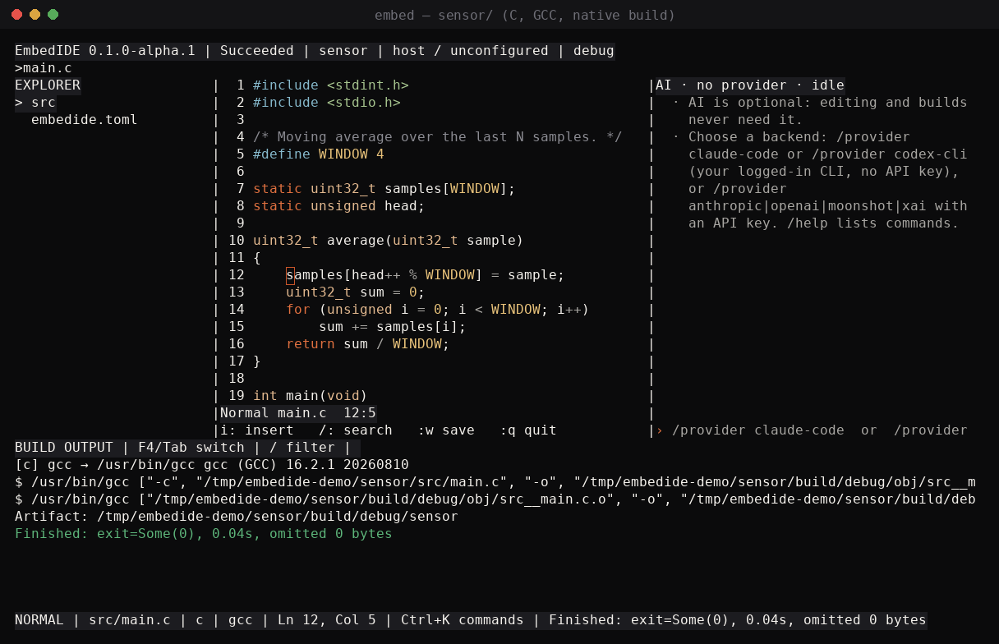
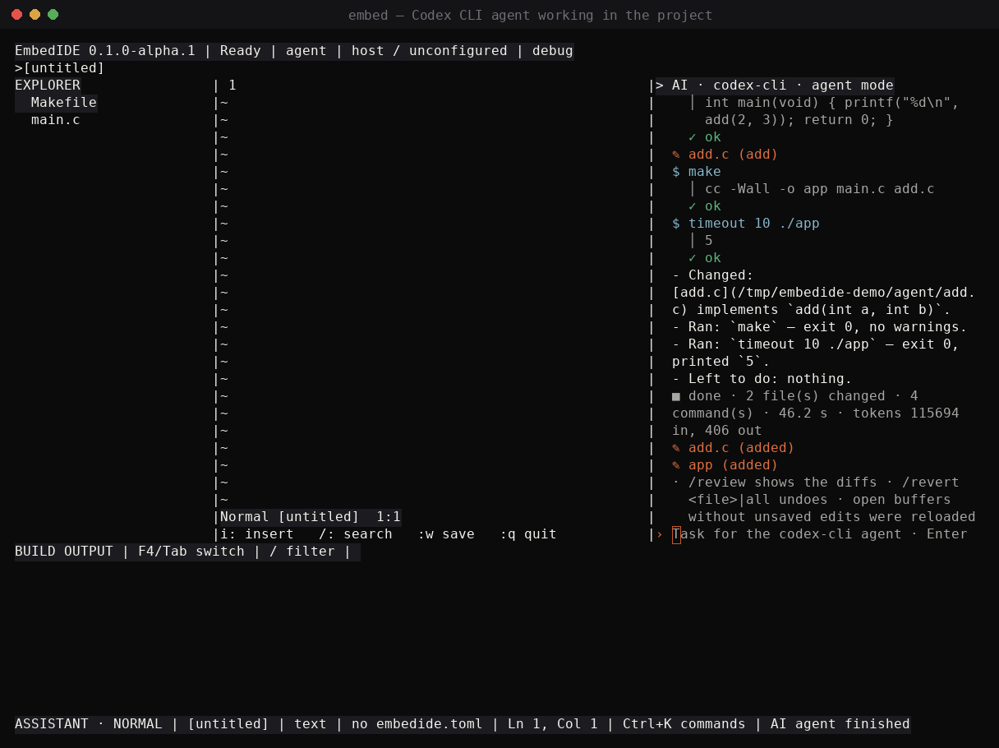
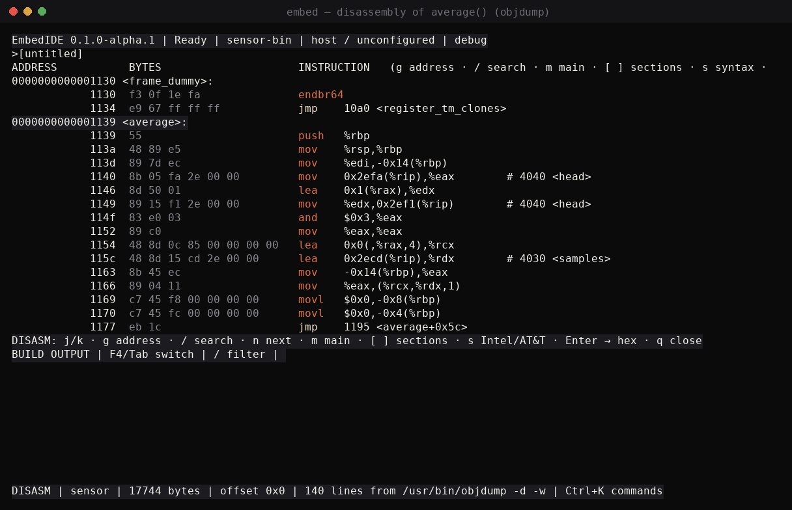

<p align="center">
  <picture>
    <source media="(prefers-color-scheme: dark)" srcset="Desige/embedide-wordmark-on-dark.svg">
    
  </picture>
</p>

<h3 align="center">A native Rust IDE for embedded and systems development — in your terminal.</h3>

<p align="center">
  <a href="https://github.com/Kirpich-Space/EmbedIDE/releases"></a>
  <a href="LICENSE"></a>
  
  
</p>

EmbedIDE (`embed`) is a full-screen, keyboard-driven IDE for people who build firmware, drivers and
systems software: a Vim-style editor, a project explorer, a real PTY terminal, builds with jump-to-source
diagnostics, an ELF/HEX/disassembly view for the binaries you produce, and AI agents that work *inside
your project* through the Claude Code or Codex CLI you already use — with permissions you control.
One Rust binary (a fully static build is published). No Electron, no browser, no telemetry, no EmbedIDE account.

You choose the compilers (GCC, Clang, `zig cc`, `arm-none-eabi-gcc`, NASM, …); EmbedIDE detects what is
installed. It downloads a compiler only if your own `config.toml` names it (HTTPS URL + SHA-256), and it
never flashes anything on its own.



<table>
<tr>
<td width="50%"><br><sub><b>Agent mode</b> — Codex CLI creates <code>add.c</code>, builds with <code>make</code>, runs the program; every step and file change is shown, reviewable and revertible.</sub></td>
<td width="50%"><br><sub><b>Binary view</b> — HEX, ELF inspector and disassembly of the program you just built (objdump).</sub></td>
</tr>
</table>

<sub>All screenshots are real: `scripts/render-screenshots.py` runs the released binary in a pseudo-terminal and draws its screen.</sub>

> EmbedIDE is a pure **Rust** project: the core, build engine, toolchain management and AI layer are
> crates, used by the **`embed`** terminal IDE. A native GUI is **planned, not started**. The earlier
> Electron/React desktop application has been removed (it remains in the git history before the commit
> "Remove the legacy Electron application").

**Supported systems: Linux (verified) and FreeBSD (compiled and linted, not yet run).** Windows and macOS are not supported.

## 0.1.0-alpha.1 — first public alpha

An **alpha**: usable for real work in the terminal, with rough edges. What was checked, and how, is in
[Verified and unverified functionality](docs/cli/status.md).

| Status | What |
|---|---|
| **Works** (automated tests + real tools on Linux x86_64) | Terminal IDE `embed`: editor with Vim modes, tabs, explorer, search, integrated terminal (PTY), build output and PROBLEMS with jump-to-source; native builds of C, C++, Rust (Cargo) and C + GNU assembly with GCC; ELF inspector, HEX viewer/editor, disassembly (objdump); AI panel with Claude Code as agent (run live) and chat; skills; official Carbon/Bone theme |
| **Experimental** (implemented, verified only with mocks or not at all) | Codex CLI as agent (mock CLI; the live run was blocked by a broken local Codex install); API providers Anthropic/OpenAI/Moonshot/xAI (mock server); Zig and Fortran builds; cross builds for Cortex-M (`c-cortex-m`, needs `arm-none-eabi-gcc`); serial bridge, OpenOCD/probe-rs/GDB services (no hardware); LSP completion (clangd, rust-analyzer, zls); FreeBSD (compiled and linted, never run), Linux musl |
| **Planned** | Native Rust GUI (not started — the TUI is the interface of this release); DWARF source mapping in the binary view; warm completion sessions |

Hardware is never touched automatically: flashing and debugging need an explicit target and command.

## `embed` — the terminal IDE (Rust)

`embed` opens a full-screen, keyboard-driven IDE in your terminal:

```
┌ EmbedIDE 0.1.0-alpha.1 | build status | project | target | profile ──────────────────────────────┐
│ EXPLORER (C-A-1) │ editor tabs, Vim modes, syntax highlighting           │ AI (C-A-2)    │
│                  │                                                        │ chat, context │
│                  │                                                        │ edits, review │
├ TERMINAL (C-A-3) — your shell in a real PTY │ BUILD OUTPUT │ PROBLEMS │ … (F4) ──────────┤
└ NORMAL | src/main.c | c | gcc | Ln 12, Col 5 | message ─────────────────────────────────┘
```

```sh
cargo install --path crates/embedide-cli --locked --root ~/.local   # → ~/.local/bin/embed
command -v embed && embed --version                                  # → embed 0.1.0-alpha.1
cd my-project && embed                     # or: embed path/to/project, embed src/main.c
```

If your shell says `Unknown command: embed`, `~/.local/bin` is not on `PATH` (fish:
`fish_add_path ~/.local/bin`; bash/zsh: add `export PATH="$HOME/.local/bin:$PATH"` to the rc file).
A plain `cargo install` puts the binary in `~/.cargo/bin`, which is often not on `PATH` either.
**New here? Read [Getting started](docs/cli/getting-started.md)** — install, a first project, keys,
the embedded workflow and known limitations of this alpha.

Panels: **Alt+1** explorer, **Alt+2** AI assistant, **Alt+3** terminal (press again to return to the
editor; Ctrl+Alt+1/2/3 work too). Holding Alt and the digit and pressing Delete hides a panel in terminals
with the kitty keyboard protocol; elsewhere use `:hide_*` commands or your own bindings — see
[what terminals can report](docs/cli/tui.md#what-terminals-can-report). F5 builds, F3 shows problems (Enter jumps to the source line), F8 cancels, Ctrl+K opens the
command palette, `:help` lists every key. In the integrated terminal Shift+PageUp/PageDown/Home/End
scroll through history; the mouse works (click to focus, wheel, drag in the AI panel to select and copy its text; `:mouse` toggles it). Enter indents by language, and a completion
popup appears while you type (rust-analyzer, clangd and zls when installed, otherwise words of the
file). See [the TUI guide](docs/cli/tui.md).

**AI, binaries and assembly** in this alpha:

- **Claude Code and Codex CLI as AI backends** — `/provider claude-code` or `/provider codex-cli` in the
  AI panel uses your installed, already logged-in official CLI (your subscription, no API key, no second
  login), streams the answer, and gives the model no file access (Claude Code) or a read-only sandbox
  (Codex). See [AI](docs/cli/ai.md#claude-code-and-codex-cli-backends-claude-code-codex-cli).
- **Agent mode (default with a CLI backend)** — after `/provider codex-cli` or `/provider claude-code`,
  an ordinary request ("fix the build errors", "make me a script that …") is a task: Claude Code or
  Codex CLI work in the project: read, search,
  create, edit and delete files, run builds and tests and fix the errors, under a policy you choose
  (`read-only`, `workspace-write`, `approval-required`). Every command, file change and refusal is
  shown; destructive, privileged, network, hardware and out-of-workspace actions ask first (`y` / `a`
  / `n`); `/review` and `/revert` work on what really changed; `/cancel` stops every process. See
  [agent mode](docs/cli/agents.md).
- **Inline AI suggestions** — `Alt+\` shows a (multi-line) suggestion as ghost text, Tab accepts,
  Esc dismisses; optional automatic mode; any backend, including `codex-cli` without an API key. See
  [inline suggestions](docs/cli/ai.md#inline-suggestions).
- **Skills** — agents get EmbedIDE's built-in working instructions and the skills that fit the
  project (C/C++, firmware, board bring-up, Rust, Zig, assembly) automatically; your own `SKILL.md`
  files per project (`.embedide/skills`) or globally (`~/.config/embedide/skills`) replace or extend
  them (`/skill <name>`). See [skills](docs/cli/skills.md).
- **Assembly** — NASM, GNU as AT&T/Intel, ARM, AArch64 and RISC-V dialects detected per file; branch
  highlighting, labels (`:label`), completion of labels/instructions/registers, assembler errors in
  PROBLEMS; [examples/asm](examples/asm).
- **Binary files** — HEX viewer with search and a confirmed, undoable edit mode; ELF inspector (headers,
  segments, sections, symbols); disassembly via objdump/llvm-objdump. See
  [binary files](docs/cli/tui.md#binary-files-hex-elf-and-disassembly).

You choose the compilers. EmbedIDE detects what is installed — GCC, Clang, `zig cc` / `zig c++`,
rustc/Cargo, Zig, GNU as, NASM, gfortran, Flang, LFortran and triple-prefixed cross GCCs — and builds
with exactly what you select in `embedide.toml` (per project and profile) or in your user
`config.toml`. It downloads a toolchain only when your own `config.toml` describes it with a pinned
HTTPS URL and SHA-256 (see [Toolchain downloads](docs/cli/configuration.md#toolchain-downloads)); it never
flashes hardware and never starts a debugger by itself. AI is optional: without a provider the IDE works fully offline.

The same services are scriptable through subcommands:

```sh
embed doctor                                     # OS, config, toolchains per language
embed toolchain list                             # versions, paths, host/cross
embed project init hello --language c --toolchain c=clang
embed build hello                                # native build with clang
embed build hello --toolchain c=zig-cc           # same project, zig cc
embed build hello --profile release
embed clean hello
embed terminal hello                             # your shell, project env + toolchain dirs on PATH

embed project init fw --template c-cortex-m --board stm32f407vg
embed build fw                                   # arm-none-eabi-gcc → fw/build/debug/fw.elf

embed ai providers                               # Anthropic, OpenAI, Moonshot (Kimi), xAI (Grok)
embed ai chat "Why does this hard-fault?" --file src/main.c --provider anthropic --model <id> --dry-run
embed ai agent --provider codex-cli "make the unit tests pass"   # agent task in the project
embed ai skills                                  # project, extra and global skills
```

- [Getting started: install, first project, embedded workflow](docs/cli/getting-started.md)
- [TUI guide: panels, keys, configuration](docs/cli/tui.md)
- [Command reference](docs/cli/commands.md)
- [`embedide.toml` reference](docs/cli/embedide-toml.md)
- [AI subsystem](docs/cli/ai.md) · [agent mode](docs/cli/agents.md) · [skills](docs/cli/skills.md)
- [Tutorials](docs/cli/tutorials.md) · [keys and commands](docs/cli/keys.md) · [configuration](docs/cli/configuration.md) · [troubleshooting and FAQ](docs/cli/troubleshooting.md)
- [Architecture](docs/cli/architecture.md) · [contributing](CONTRIBUTING.md) · [all documentation](docs/README.md)
- [Verified and unverified functionality](docs/cli/status.md)

No Node.js or graphical session is needed. The binary links only against the C runtime.

## Requirements and build

- Rust 1.85+ (`cargo build --release --locked`; offline builds need the cached registry dependencies)
- Linux or FreeBSD (verified on Linux x86_64; FreeBSD is type-checked and linted but not yet run);
  Windows and macOS are not supported
- Host toolchains of your choice for building projects: GCC/Clang, `arm-none-eabi-gcc`, `rustc`/`cargo`,
  `zig`, NASM/GNU as, `make`/CMake; `openocd`/`probe-rs` for hardware (never run automatically)

```bash
cargo build --release --locked
cargo install --path crates/embedide-cli --locked --root ~/.local   # installs `embed`
embed doctor
```

Checks used in development:

```bash
cargo fmt --all -- --check
cargo clippy --workspace --all-targets --locked -- -D warnings
cargo test --workspace --locked
python3 scripts/check-embed-pty.py --binary target/release/embed
```

## Try it (alpha testers)

Linux x86_64, no root, nothing installed system-wide (the static build runs on any distribution):

```sh
curl -fsSL https://raw.githubusercontent.com/Kirpich-Space/EmbedIDE/main/install.sh | sh
embed doctor      # what EmbedIDE found on your machine
embed             # open the IDE in the current directory (Ctrl+K: commands, F1: help, Ctrl+Q: quit)
```

(or download `install.sh` first and read it; it verifies the SHA-256 checksum of the download.) FreeBSD:
build from source, see below. Start with the [tutorials](docs/cli/tutorials.md).

**Found a problem?** Please [open an issue](https://github.com/Kirpich-Space/EmbedIDE/issues/new/choose)
with `embed --version`, the output of `embed doctor`, your terminal and the steps to reproduce.
Crashes, wrong colours or keys in your terminal, FreeBSD build errors, agent behaviour you did not
expect and unclear documentation are all useful. Security problems: [SECURITY.md](SECURITY.md).

## Install a release archive

Release archives are named `embed-<version>-<target>.tar.gz` and come with `SHA256SUMS`. The `-musl` archive is
static and runs on any Linux x86_64; the `-gnu` archive is dynamic (glibc 2.39+):

```sh
sha256sum -c SHA256SUMS --ignore-missing          # verify the download
tar -xzf embed-0.1.0-alpha.1-x86_64-unknown-linux-gnu.tar.gz
install -m 0755 embed-0.1.0-alpha.1-x86_64-unknown-linux-gnu/embed ~/.local/bin/embed
embed --version                                    # → embed 0.1.0-alpha.1
embed doctor
```

The `x86_64-unknown-linux-gnu` archive needs glibc 2.39 or newer (Ubuntu 24.04+, Debian 13+, Fedora
40+, Arch). Only targets that were built and run are published; on musl systems (Void musl, Alpine),
FreeBSD, build from source (above; on FreeBSD install `rust` and `gmake` with `pkg`). Windows and macOS
are not supported.

## AI providers

AI is optional. In the AI panel (Alt+2):

- `/provider codex-cli` or `/provider claude-code` — your installed, logged-in official CLI (no API
  key). **Plain text is then a task for the agent**: "fix the compilation errors", "make me a script
  that …" — it reads, creates and edits files in the project, runs builds and tests, and reports what
  changed. `/mode chat` switches to read-only answers; `/policy` chooses `read-only`,
  `workspace-write` (default) or `approval-required`; `/review`, `/revert`, `/cancel` work on every task.
- `/provider anthropic | openai | moonshot | xai` with an API key (`embed ai login <provider>`): chat,
  `/edit` diffs and inline completion; API backends never edit files by themselves.

See [AI subsystem](docs/cli/ai.md), [agent mode](docs/cli/agents.md) and [skills](docs/cli/skills.md).

## Troubleshooting

- **`Unknown command: embed`** — `~/.local/bin` is not on `PATH` (see above).
- **Colours look wrong** — set `COLORTERM=truecolor` if your terminal supports 24-bit colour; otherwise
  the nearest 256 colours are used. `theme = "mono"` uses only your terminal's colours.
- **Agent does nothing / "tool host failed to start"** — run the same task with the CLI alone
  (`codex exec "…"`, `claude -p "…"`); if that fails too, reinstall or log in to that CLI. Codex
  0.167 installs that lack `codex-code-mode-host` cannot run tools at all.
- **Plain text only chats** — the backend is an API provider, or `/mode chat` is set (`/mode agent`).
- **Keys like Alt+digit+Delete do nothing** — your terminal does not report them; use `:hide_*`
  commands. See [what terminals can report](docs/cli/tui.md#what-terminals-can-report).
- **Build ignores the latest edit** — builds use files on disk; save (`:w`) before F5.

## Videos

Official Kirpich Space videos of the real program (version 0.1.0-alpha.1; recordings are real, animations
and time-lapses are labelled). English narration and a Russian dub in the same AI-synthesised voice (Microsoft Emma, free neural TTS), with subtitles:

| Video | English | Русский дубляж |
|---|---|---|
| Overview, ~4 min | [mp4](https://github.com/Kirpich-Space/EmbedIDE/releases/download/v0.1.0-alpha.1/embedide-overview-0.1.0-alpha.1.mp4) · [subtitles](https://github.com/Kirpich-Space/EmbedIDE/releases/download/v0.1.0-alpha.1/embedide-overview-0.1.0-alpha.1.en.srt) | [mp4](https://github.com/Kirpich-Space/EmbedIDE/releases/download/v0.1.0-alpha.1/embedide-overview-0.1.0-alpha.1.ru.mp4) · [субтитры](https://github.com/Kirpich-Space/EmbedIDE/releases/download/v0.1.0-alpha.1/embedide-overview-0.1.0-alpha.1.ru.srt) |
| Technical demonstration, ~4 min | [mp4](https://github.com/Kirpich-Space/EmbedIDE/releases/download/v0.1.0-alpha.1/embedide-technical-demo-0.1.0-alpha.1.mp4) · [subtitles](https://github.com/Kirpich-Space/EmbedIDE/releases/download/v0.1.0-alpha.1/embedide-technical-demo-0.1.0-alpha.1.en.srt) | [mp4](https://github.com/Kirpich-Space/EmbedIDE/releases/download/v0.1.0-alpha.1/embedide-technical-demo-0.1.0-alpha.1.ru.mp4) · [субтитры](https://github.com/Kirpich-Space/EmbedIDE/releases/download/v0.1.0-alpha.1/embedide-technical-demo-0.1.0-alpha.1.ru.srt) |
| Short, 42 s (vertical) | [mp4](https://github.com/Kirpich-Space/EmbedIDE/releases/download/v0.1.0-alpha.1/embedide-short-0.1.0-alpha.1.mp4) · [subtitles](https://github.com/Kirpich-Space/EmbedIDE/releases/download/v0.1.0-alpha.1/embedide-short-0.1.0-alpha.1.en.srt) | [mp4](https://github.com/Kirpich-Space/EmbedIDE/releases/download/v0.1.0-alpha.1/embedide-short-0.1.0-alpha.1.ru.mp4) · [субтитры](https://github.com/Kirpich-Space/EmbedIDE/releases/download/v0.1.0-alpha.1/embedide-short-0.1.0-alpha.1.ru.srt) |

The files are H.264 + AAC. If your VLC says "codec not supported", install its ffmpeg plugin
(Arch/Artix: `vlc-plugin-ffmpeg`) or use `mpv`. The pipeline that records and renders them from the real
binary is in [marketing/video](marketing/video).

## Roadmap

Honest and short; nothing here is promised for a date.

- **Now (alpha):** terminal IDE, builds, binary view, AI agents and skills — collecting real-world bug reports.
- **Next:** FreeBSD verification and a ports entry, DWARF source mapping in the binary view, warm
  completion sessions for faster AI suggestions, more per-terminal key testing.
- **Later:** a native Rust GUI sharing the same crates. Not started.

## Contributing

Contributions of every size are welcome — bug reports from your terminal and OS count as much as code.
Start with [CONTRIBUTING.md](CONTRIBUTING.md); [docs/cli/architecture.md](docs/cli/architecture.md) maps
the crates. Good first areas: testing on your terminal emulator and on FreeBSD, tutorials for a board you
own, assembly dialect and toolchain edge cases. Please
[open an issue](https://github.com/Kirpich-Space/EmbedIDE/issues/new/choose) with `embed --version` and
`embed doctor`. A note on transparency: parts of this code base were written with AI coding assistants
(see the `Co-Authored-By` trailers); every change goes through the same tests.

## Known alpha limitations

See [docs/cli/status.md](docs/cli/status.md#known-limitations). In short: Linux is the only verified
platform; no native GUI; hardware workflows (flash, debug, serial) are untested on real devices; native
compiles run sequentially; Codex agents have plan-level rather than per-command approval.

## Security

Report vulnerabilities privately — see [SECURITY.md](SECURITY.md).

## Project layout

```
EmbedIDE/
├── crates/            # embedide-project, -core, -editor, -terminal (TUI), -toolchains, -workspace,
│                      # -build, -ai, -cli (binary `embed`)
├── docs/              # cli/ (user guides), native/ (design notes)
├── examples/          # asm, native project examples
└── scripts/           # PTY and CLI verification scripts
```

## License

GNU General Public License v3.0 only (`GPL-3.0-only`) — see [LICENSE](LICENSE). You may use, study, modify
and redistribute EmbedIDE; distributed modified versions must stay under the GPL with their source.
Releases up to and including `0.1.0-alpha.1` were published under the MIT license; those copies keep it.
Programs you build or edit with EmbedIDE are not affected by this license.
