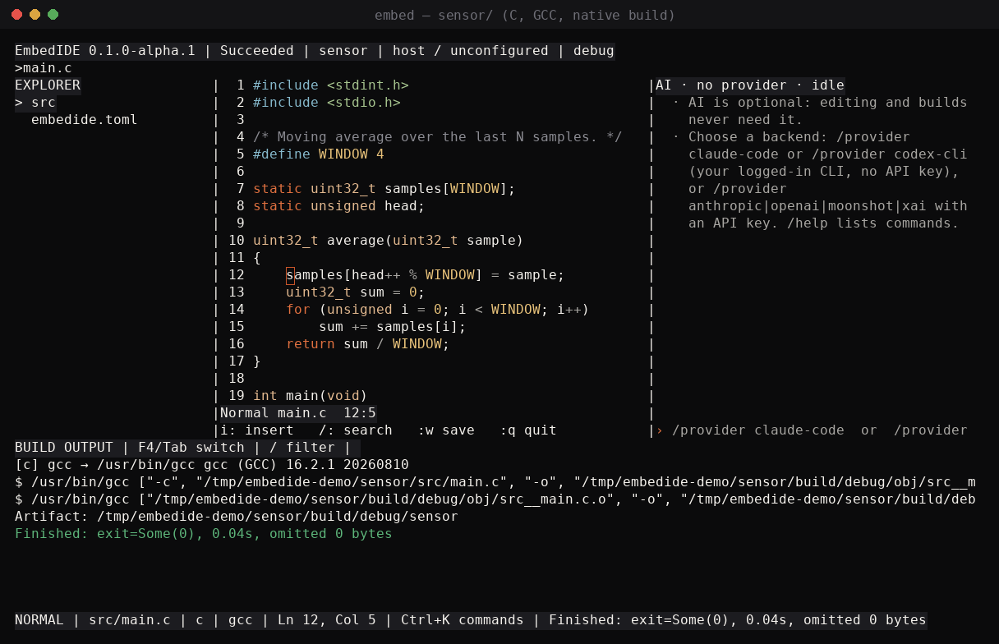
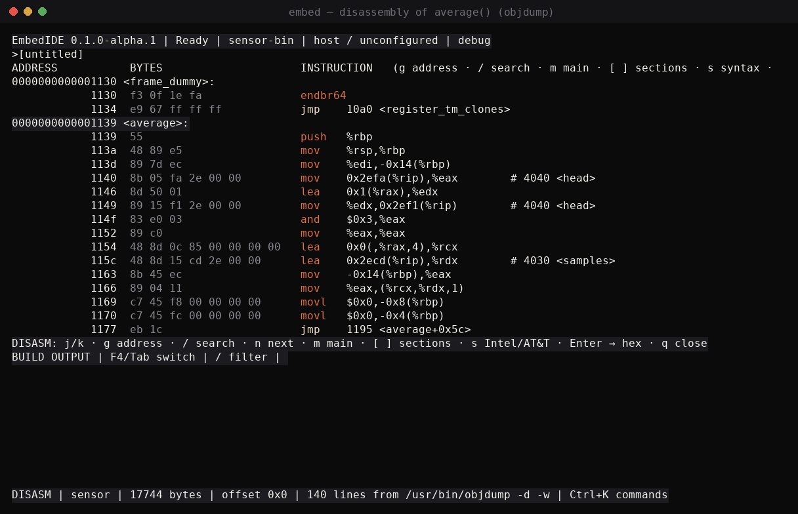
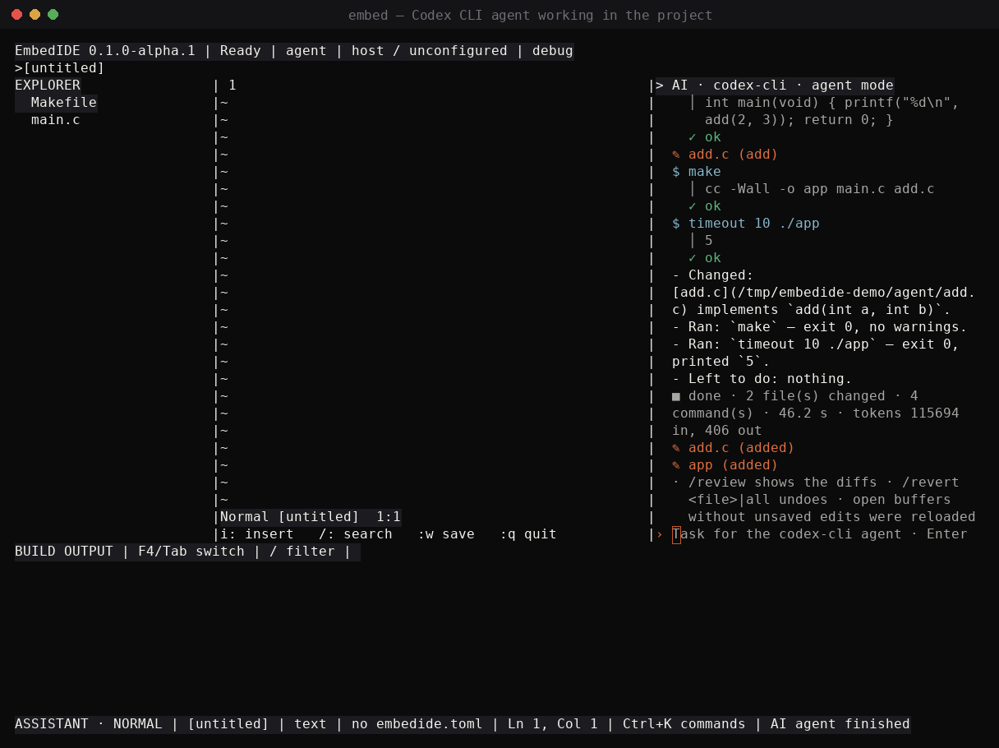

<!-- Publish on https://dev.to/new after you have read it. Keep published: false until you approve. -->

Firmware work has a rhythm: edit, build with a cross compiler, read errors, look at what the compiler
actually produced, repeat. For years mine involved an editor, a Makefile, `objdump`, `readelf` and a hex
editor in different windows. **EmbedIDE** (`embed`) is my attempt to put that loop in one terminal
application, written in Rust. It is an alpha — this post covers what exists, how it is built, and what
is not done.



## What you get today

- A **Vim-style editor** (modes, counts, yank/paste, search, undo/redo, Unicode-aware),
  syntax highlighting for C, C++, Rust, Zig, assembly and more, language-aware indentation.
- An **explorer**, a real **PTY terminal** panel with scrollback, and a **build panel**: F5 builds, errors
  from GCC/Clang/rustc/NASM/GNU as are parsed, and Enter jumps to the line and column.
- **Toolchains are yours**: it detects GCC, Clang, `zig cc`, `arm-none-eabi-gcc`, NASM, … and builds with
  exactly what you pick per project and profile. It never installs or flashes anything.
- A **binary view** for what you built: paged HEX viewer/editor, an ELF inspector (sections, symbols,
  vector table) and an objdump disassembly view.



## How it is put together

A Cargo workspace of nine crates. The decision I'm happiest with: the **editor crate has no I/O and no
terminal types**. It is a piece table with bounded undo, a Vim input parser that turns logical keys into
typed actions, an executor, lexers and an incremental highlighter. The terminal UI is a thin adapter —
which means a future native GUI can reuse the engine unchanged.

The **build engine** produces a reviewable plan first (every command, no shell, absolute paths) and then
runs it with process-group cancellation, so Ctrl+C really stops the compiler *and* what it spawned. Native
builds are incremental from the compiler's depfiles; or it drives your existing Make/CMake/Cargo/Zig
project without touching its files.

The TUI uses crossterm, vt100 and portable-pty. The screen writer diffs frames and sends only changed
cells; keyboard input uses the kitty protocol when the terminal offers it, with a legacy fallback. Colours
come from one theme module with contrast tests (≥ 4.5:1 for text).

The workspace forbids `unsafe`, launches processes with argument vectors, and writes files atomically
while refusing to overwrite a file that changed on disk. There are 361 Rust tests plus Python suites that
drive the **real binary through a pseudo-terminal** — that is where most of the bugs I found lived.

## Letting CLI agents in — carefully

The part people ask about. EmbedIDE does not need API keys for AI: it can run the **Claude Code** or
**Codex** CLI you already have logged in, as a child process, and make them work in your project.

- Claude Code is driven over its stream-json host protocol: every tool call that its own rules don't
  already allow arrives at EmbedIDE, which answers from a policy — **read-only**, **workspace-write**
  (edits and ordinary build/test commands inside the project run; deleting data, `sudo`, network, hardware
  tools and anything outside the workspace ask first) or **approval-required**. Shell commands are parsed
  (quotes, `&&`, pipes, redirections, loops) without running a shell, and the rules ask when unsure.
- Codex has no per-command approval in `exec` mode, so it runs in its own OS sandbox, and in
  approval-required mode it plans read-only first and executes only after you approve the plan.
- A workspace snapshot before each task powers `/review` (diffs) and `/revert`.
- API-key variables are removed from the CLI's environment, so a subscription request can never silently
  become billed API usage, and EmbedIDE never reads the CLIs' credentials.



Skills (`SKILL.md` files) add your team's rules; they are quoted to the agent as untrusted guidance and
cannot change permissions.

## What is not done

I'd rather you hear it from me:

- Linux is the only platform I have run it on. FreeBSD cross-compiles and lints, but has not been run.
  Windows and macOS are not supported.
- Flashing, debugging and serial are implemented as explicit commands but **untested on real hardware**.
- It's a terminal app; a native GUI is planned and not started.
- Parts of the code were written with AI assistants; the commits say so, and everything goes through the
  same tests.
- Inline AI suggestions through the subscription CLIs take several seconds, so they're manual by default.

## Try it, break it

```sh
curl -fsSL https://raw.githubusercontent.com/Kirpich-Space/EmbedIDE/main/install.sh | sh
embed doctor
embed
```

It's GPL-3.0. If you have a board, a terminal emulator I haven't tried, or a FreeBSD box, bug reports with
`embed --version` and `embed doctor` are the most useful thing you can send:
https://github.com/Kirpich-Space/EmbedIDE/issues/new/choose
